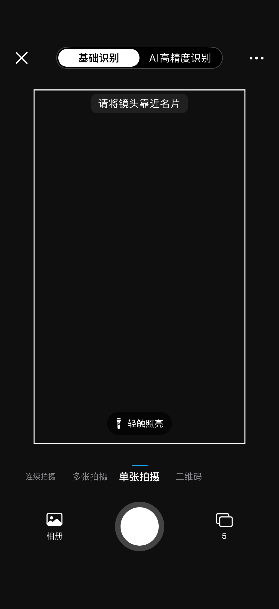
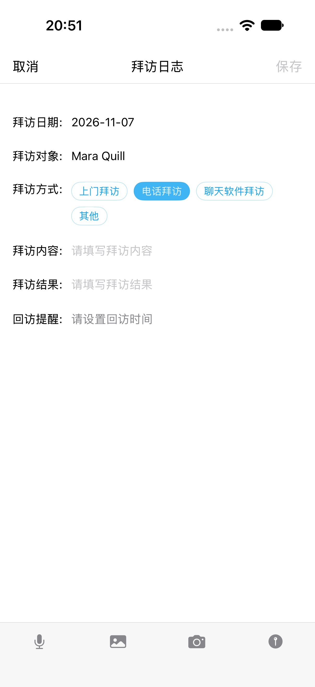

# CamCard · 名片数字化与联系人管理

CamCard 是一款 iOS 名片管理应用，参考「名片全能王」的名片采集、识别和管理流程。使用 Swift、SwiftUI、AVFoundation 和 Apple Vision，支持从拍摄或导入名片，到人工校对、保存、搜索和导出联系人的完整流程。文字识别在设备端运行，名片及其附件保存在应用沙盒。

## 主要功能

- **扫描与导入**支持单张拍摄、连续拍摄、多张拍摄、二维码和相册导入。拍摄页面提供实时预览、快门和补光。
- **图像校正与识别**支持自动检测边界、透视校正、旋转及手动调整角点。Apple Vision 识别中英文文字，应用分别保留原图、校正图、OCR 原文和字段候选值。
- **人工校对与管理**支持修改、增加或清空字段，确认后保存。可按姓名、公司、职位、电话或邮箱搜索，并管理分组、收藏、备注和拜访日志。
- **联系人导出**支持存入系统通讯录和导出 VCF。详情页可打开系统电话、邮件和网站入口。

| 单张拍摄 | 名片详情 | 拜访日志 |
| --- | --- | --- |
|  |  |  |

## 运行与演示

本地运行环境为 Xcode 27.2（27B52）、iPhone 18 Pro 模拟器和 iOS 27.2。打开 `CamCard.xcodeproj`，选择共享的 `CamCard` Scheme 和该模拟器，然后运行。以下命令均在仓库根目录执行。使用 `simctl … booted` 时，请只启动用于本项目的模拟器。

```sh
# 将演示样本导入已启动的模拟器。
xcrun simctl addmedia booted tests/fixtures/business-cards/images/CC-001.png
```

1. 从名片夹进入扫描页，打开「相册」，勾选 CC-001 后点「完成」。
2. 查看校正图和 OCR 原文，进入裁剪页调整边界，再修改一个联系人字段并保存。
3. 在详情中查看名片、添加分组或备注。回到名片夹搜索该名片，重启应用后检查数据是否保留。
4. 在详情中选择「存入通讯录」，或通过「更多 → 导出 VCF」生成文件。VCF 可在 iOS「文件」的「我的 iPhone → CamCard → VCF」中查看。

只演示名片详情时，可在 Scheme 的 Run 参数中加入 `--demo-cards`，启动后打开合成名片 Mara Quill。

## 复现测试

先启动专用模拟器，然后执行以下命令构建、安装并准备 UI 测试所需的图片和权限。

```sh
camcard_destination='platform=iOS Simulator,name=iPhone 18 Pro,OS=27.2'

xcodebuild -project CamCard.xcodeproj -scheme CamCard \
  -destination "$camcard_destination" \
  -derivedDataPath DerivedData CODE_SIGNING_ALLOWED=NO build

xcrun simctl install booted DerivedData/Build/Products/Debug-iphonesimulator/CamCard.app
xcrun simctl addmedia booted tests/fixtures/business-cards/images/CC-001.png \
  tests/fixtures/business-cards/images/CC-016.png \
  tests/fixtures/business-cards/images/CC-017.png \
  tests/fixtures/business-cards/images/CC-030.png
xcrun simctl privacy booted grant photos com.yepiphany.camcard
xcrun simctl privacy booted grant contacts com.yepiphany.camcard

xcodebuild -project CamCard.xcodeproj -scheme CamCard \
  -destination "$camcard_destination" \
  -derivedDataPath DerivedData -parallel-testing-enabled NO CODE_SIGNING_ALLOWED=NO test
```

### OCR 跑分

跑分沿用应用的基础识别设置，直接调用项目的 Vision 和字段提取代码，输出 OCR 原文、候选值及字段计分。

```sh
score_dir=$(mktemp -d)
xcrun --sdk iphonesimulator swiftc \
  -sdk "$(xcrun --sdk iphonesimulator --show-sdk-path)" \
  -target "$(uname -m)-apple-ios27.0-simulator" \
  CamCard/BusinessCard.swift CamCard/ContactExtraction.swift CamCard/ScanProcessor.swift \
  scripts/ScoreRecognition.swift -o "$score_dir/score-recognition"
xcrun simctl spawn booted "$score_dir/score-recognition" \
  "$PWD/tests/fixtures/business-cards" | tee "$score_dir/recognition.log"
```

### 模型与数据兼容性

此检查覆盖重识别时的姓名草稿合并、合成二维码解码，以及旧备注和附件数据的读写。

```sh
model_dir=$(mktemp -d)
xcrun --sdk iphonesimulator swiftc \
  -sdk "$(xcrun --sdk iphonesimulator --show-sdk-path)" \
  -target "$(uname -m)-apple-ios27.0-simulator" \
  CamCard/BusinessCard.swift CamCard/CardRepository.swift CamCard/ContactExtraction.swift \
  CamCard/ScanProcessor.swift scripts/CheckAcceptanceModels.swift -o "$model_dir/check-acceptance"
xcrun simctl spawn booted "$model_dir/check-acceptance"
```

## 项目文档

- [需求](docs/requirements.md) · [黑盒规格](docs/spec.md) · [用户故事](docs/user-stories.md)
- [架构](docs/architecture.md) · [数据模型](docs/database.md) · [内部接口](docs/api.md) · [界面规格](docs/ui-spec.md)
- [阶段计划](docs/plan.md) · [任务清单](docs/tasks.md) · [技术决策](docs/decisions.md) · [协作约定](AGENTS.md)
